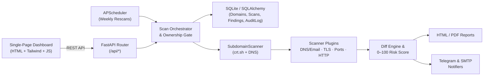

# SurfaceWatch

**Open-source external attack-surface monitor for small businesses.**

Small businesses rarely know every subdomain, SSL certificate, email authentication gap, open database port, or leaked `.env`/`.git` path exposed on their public domain. **SurfaceWatch** gives business owners and IT generalists a self-hosted, defensive monitoring dashboard that tracks public exposures over time, explains each risk in plain English, and highlights exactly what changed since the previous scan.

> **Legal & Ethical Notice:** SurfaceWatch is strictly a **defensive** tool. Only scan domains you directly own or have explicit written authorization to test. Scans are blocked until ownership is verified.

---

## Key Features

- **Mandatory Ownership Gate**: Refuses scanning (`HTTP 403`) until the user proves domain ownership via a DNS TXT token (`_surfacewatch-verify.<domain>`) or submits an explicit timestamped authorization attestation.
- **Passive Subdomain Discovery**: Queries Certificate Transparency (`crt.sh` JSON API) and resolves public DNS records without brute-forcing.
- **DNS & Email Security**: Audits SPF records, common DKIM selectors, DMARC policy strength (`p=none` vs `quarantine`/`reject`), and dangling CNAME takeover risks.
- **TLS Certificate Inspection**: Flags expired certificates, 30/14/7-day expiry warnings, hostname mismatches, self-signed chains, and legacy TLS 1.0/1.1 support.
- **Safe Connect-Only Port Checks**: Checks a small fixed list of common ports (`21, 22, 23, 25, 80, 443, 445, 3306, 3389, 5432, 6379, 8080, 27017`) on discovered public hosts only—no payloads, no exploitation.
- **HTTP Exposure Checks**: Detects missing security headers (`HSTS`, `CSP`, `X-Frame-Options`, `X-Content-Type-Options`) and single-`GET` sensitive paths (`/admin`, `/.git/HEAD`, `/.env`, `/phpinfo.php`).
- **Plain-Language Findings & 0–100 Risk Score**: Every finding includes severity, plain-English business impact, concrete evidence, and remediation steps.
- **Change Detection ("What Changed")**: Compares each scan to the previous scan to show **New**, **Resolved**, and **Unchanged** findings.
- **Weekly Scheduling & Notifications**: Automated APScheduler weekly rescans per domain with Telegram Bot and SMTP email summaries, plus downloadable **HTML** and **PDF** reports.
- **Immutable Audit Trail**: Records every verification event, scan run, blocked unverified scan, and report export.

---

## Architecture



---

## Quick Start (3 Commands)

```bash
git clone https://github.com/your-org/surfacewatch.git && cd surfacewatch
cp .env.example .env
docker compose up --build
```

Then open **http://localhost:8000** in your browser.

---

## Screenshots

> *Placeholder: Add screenshots of your live instance below after capturing them.*
>
> - `docs/screenshots/dashboard-overview.png` — Domain list, 0–100 Risk Score, and Findings table
> - `docs/screenshots/ownership-gate.png` — DNS TXT & Attestation verification gate
> - `docs/screenshots/what-changed.png` — Scan diff timeline showing New vs. Resolved issues

---

## Scanner Plugins

All scanners implement the common `Scanner.run(target) -> list[Finding]` interface in `scanners/base.py`:

| Scanner | File | Scope & Safety Controls |
| :--- | :--- | :--- |
| `SubdomainScanner` | `scanners/subdomain.py` | Passive `crt.sh` CT lookup + DNS A/AAAA/CNAME resolution; skips private/RFC1918 IPs |
| `DnsEmailScanner` | `scanners/dns_email.py` | Checks SPF, common DKIM selectors, DMARC policy strength, and dangling CNAMEs |
| `TlsScanner` | `scanners/tls_check.py` | Checks cert expiry (30/14/7/expired), SAN mismatch, self-signed, TLS 1.0/1.1 |
| `PortScanner` | `scanners/port_check.py` | Connect-only TCP check on 13 fixed ports; rate-limited; zero payloads |
| `HttpExposureScanner` | `scanners/http_exposure.py` | Checks 4 security headers + single `GET` on `/admin`, `/.git/HEAD`, `/.env`, `/phpinfo.php` |

---

## Pentest Mode (Scoped VAPT Engagements)

Pentest Mode is a separate, API-only workflow for authorized, time-boxed VAPT engagements. It adds scoped active tooling (Nmap and nuclei) and manual analyst findings on top of the existing passive monitor. Domain scanning, reports, notifications, and scheduling are unchanged.

### Flow: create → scan → manual findings → report

1. **Create an engagement** with the client, authorization reference, validity window, and explicit scope. Scope entries may be CIDR ranges (`10.0.0.0/8`), individual IPs (`203.0.113.10`), domains (`example.com`), or wildcard domains (`*.example.com`).

   ```http
   POST /api/engagements
   Content-Type: application/json

   {
     "client_name": "Acme Bakery",
     "authorization_reference": "SOW-2026-014 signed 2026-01-05",
     "scope": ["10.0.0.0/8", "*.acme-bakery.com"],
     "start_date": "2026-01-10",
     "end_date": "2026-01-24",
     "tester": "alice",
     "notes": "External perimeter test approved by the CTO."
   }
   ```

2. **Run a scoped active scan.** The scope gate (`assert_scan_allowed`) rejects expired/out-of-window engagements and out-of-scope targets with `403` before any network traffic. `nmap` and `nuclei` are invoked in safe mode from `PATH`; if a binary is missing, SurfaceWatch records an `INFO` fallback finding instead of crashing.

   ```http
   POST /api/engagements/1/scan
   Content-Type: application/json

   { "target": "10.1.2.3", "tool": "nmap", "actor": "alice" }
   ```

   ```http
   POST /api/engagements/1/scan
   Content-Type: application/json

   { "target": "https://shop.acme-bakery.com", "tool": "nuclei", "actor": "alice" }
   ```

3. **Add manual findings** (optionally attaching screenshot evidence, max 10MB, `.png/.jpg/.jpeg/.gif/.webp`).

   ```http
   POST /api/engagements/1/manual-findings
   Content-Type: application/json

   {
     "title": "Default admin credentials accepted",
     "affected_host": "admin.acme-bakery.com",
     "severity": "critical",
     "cvss_score": 9.8,
     "cvss_vector": "CVSS:3.1/AV:N/AC:L/PR:N/UI:N/S:U/C:H/I:H/A:H",
     "owasp_category": "A07 Identification and Authentication Failures",
     "description": "The admin panel accepted admin/admin.",
     "evidence": "Logged in as administrator without changing the password.",
     "remediation": "Force a password change and enable MFA.",
     "discovered_by": "alice"
   }
   ```

   ```http
   POST /api/engagements/1/manual-findings/1/screenshot
   Content-Type: multipart/form-data
   ```

   ```http
   PATCH /api/engagements/1/manual-findings/1/retest
   Content-Type: application/json

   { "status": "fixed", "retest_notes": "Password rotated and MFA enforced on 2026-01-20." }
   ```

4. **Export the VAPT report** in HTML, PDF, or DOCX. The report combines automated `FindingRecord` rows (refs `A-01`, `A-02`, ...) and manual findings (refs `M-01`, `M-02`, ...) with an executive summary, scope & methodology, findings summary table, detailed sections, retest summary, and a CONFIDENTIAL footer.

   ```http
   GET /api/engagements/1/report?format=html
   GET /api/engagements/1/report?format=pdf
   GET /api/engagements/1/report?format=docx
   ```

Every scan attempt (allowed or blocked) is written to the existing audit trail.

---

## Configuration

Configure via `.env` (see `.env.example`):

| Variable | Default | Description |
| :--- | :--- | :--- |
| `DATABASE_URL` | `sqlite:///./data/surfacewatch.db` | SQLAlchemy database connection string |
| `USER_AGENT` | `SurfaceWatch/1.0 (...)` | Explicit User-Agent sent on outbound HTTP requests |
| `REQUEST_TIMEOUT_SECONDS` | `8.0` | Timeout for HTTP and DNS queries |
| `PORT_TIMEOUT_SECONDS` | `2.0` | Timeout for connect-only TCP port checks |
| `RATE_LIMIT_REQUESTS_PER_SECOND` | `2.0` | Global outbound request pacing |
| `MAX_SUBDOMAINS` | `50` | Maximum discovered subdomains evaluated per scan |
| `DEFAULT_SCAN_INTERVAL_DAYS` | `7` | Default automatic rescan cadence |
| `ALLOW_SELF_ATTESTATION` | `true` | Allow checkbox attestation alongside DNS TXT verification |
| `TELEGRAM_BOT_TOKEN` | `""` | Optional Telegram Bot token for weekly summaries |
| `TELEGRAM_CHAT_ID` | `""` | Optional Telegram target chat ID |
| `SMTP_HOST` / `SMTP_PORT` | `""` / `587` | Optional SMTP server for email reports |
| `SMTP_USER` / `SMTP_PASSWORD` | `""` | Optional SMTP authentication credentials |
| `SMTP_FROM` / `SMTP_TO` | `""` | Sender and recipient email addresses |

---

## Limitations

- **External Perspective Only**: SurfaceWatch checks internet-facing exposures; it does not inspect internal LAN services, cloud IAM permissions, or application business logic.
- **No Exploitation or Authenticated Scanning**: By design, no vulnerability payloads, credential brute-forcing, or directory wordlists are used.
- **CT Log Completeness**: Passive discovery depends on public Certificate Transparency logs (`crt.sh`) and may miss hosts that have never been issued a public TLS certificate.
- **Single-Node Default**: SQLite is configured for straightforward small-business self-hosting; high-volume deployments should switch `DATABASE_URL` to PostgreSQL.
- **Pentest Mode is API-only**: there is no dashboard UI for engagements, active scans, manual findings, screenshots, or VAPT reports yet. Use the REST endpoints documented above.
- **No database migration system**: Pentest Mode adds new tables and columns to the existing SQLite schema. When upgrading an existing local `data/surfacewatch.db`, delete it and let SurfaceWatch recreate the database on startup; any existing local scan history will be lost.

---

## Roadmap

- Multi-user authentication & role-based team workspaces
- Webhook/Slack alert integration alongside Telegram and SMTP
- Historical risk-score trend chart on the dashboard
- Custom DKIM selector configuration per domain

---

## Legal & Ethical Use

SurfaceWatch is designed exclusively for **authorized defensive monitoring**. Scanning networks or domains without prior permission is illegal in most jurisdictions and strictly against this project's intended use. See [`SECURITY.md`](SECURITY.md) for built-in safeguards and vulnerability reporting guidelines.
